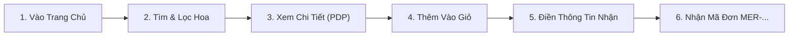

# HƯỚNG DẪN KIỂM TRA HỆ THỐNG (SYSTEM VERIFICATION & TESTING GUIDE)
**Dự án:** Website Thương mại Điện tử Mer Florist Đà Nẵng  
**Định vị thương hiệu:** *"Lãng mạn không hề đắt"*  
**Kiến trúc:** Node.js Express (Backend) + React 18 / Vite (Frontend) + MySQL (In-memory fallback)  
**Tài liệu tham chiếu:** Kế hoạch triển khai & Rubric chấm điểm Web Design  

---

## MỤC LỤC
1. [Tổng Quan Kiến Trúc & Yêu Cầu Môi Trường](#1-tổng-quan-kiến-trúc--yêu-cầu-môi-trường)
2. [Quy Trình Khởi Động Hệ Thống Nhanh](#2-quy-trình-khởi-động-hệ-thống-nhanh)
3. [Kiểm Thử Tầng Backend & API Endpoints](#3-kiểm-thử-tầng-backend--api-endpoints)
4. [Kiểm Thử Tầng Frontend & Giao Diện Người Dùng (UI/UX)](#4-kiểm-thử-tầng-frontend--giao-diện-người-dùng-uiux)
5. [Kiểm Thử Luồng Nghiệp Vụ Mua Hàng Toàn Trình (E2E Workflow)](#5-kiểm-thử-luồng-nghiệp-vụ-mua-hàng-toàn-trình-e2e-workflow)
6. [Kiểm Thử Hiệu Năng & Chỉ Số Lighthouse (Audit Web Vitals)](#6-kiểm-thử-hiệu-năng--chỉ-số-lighthouse-audit-web-vitals)
7. [Bảng Checklist Nghiệm Thu Đối Soát Theo Rubric](#7-bảng-checklist-nghiệm-thu-đối-soát-theo-rubric)
8. [Xử Lý Sự Cố Thường Gặp (Troubleshooting)](#8-xử-lý-sự-cố-thường-gặp-troubleshooting)

---

## 1. TỔNG QUAN KIẾN TRÚC & YEU CẦU MÔI TRƯỜNG

### 1.1. Sơ đồ luồng hoạt động
```
[ Khách hàng / Trình duyệt ] 
          │  (Port 3000)
          ▼
   [ Frontend React + Vite ] 
          │  Vite Proxy: /api ──► http://localhost:5000/api
          ▼
   [ Backend Node.js Express ] (Port 5000)
     ├── Health Check & Shop Info
     ├── Product Discovery & Accent-insensitive Search
     ├── Custom Bouquet Builder Logic
     └── Orders & Checkout Validation
          │
          ├──► [ MySQL Database ] (Nếu có kết nối DB)
          └──► [ In-Memory Safe Fallback ] (Chạy mượt độc lập không lo sập server)
```

### 1.2. Điều kiện tiên quyết
* **Node.js:** Phiên bản `>= 18.0.0` (Khuyến nghị bản LTS v20.x hoặc v22.x).
* **Package Manager:** `npm` `>= 9.0.0`.
* **Trình duyệt web:** Google Chrome, Microsoft Edge, Firefox hoặc Safari (hỗ trợ kiểm tra Responsive và DevTools).
* **Cơ sở dữ liệu (Tùy chọn):** MySQL `>= 8.0`. *(Lưu ý: Hệ thống đã tích hợp sẵn cơ chế In-Memory Fallback tự động lấy dữ liệu từ `products.js`, cho phép kiểm thử toàn diện ngay cả khi chưa bật MySQL).*

---

## 2. QUY TRÌNH KHỞI ĐỘNG HỆ THỐNG NHANH

Mở 2 cửa sổ Terminal (PowerShell hoặc Command Prompt) độc lập:

### Bước 2.1: Khởi động Backend API (Port 5000)
```powershell
# Chuyển vào thư mục backend
cd e:\merflorist\backend

# Cài đặt thư viện (nếu mới clone hoặc chưa cài)
npm install

# Khởi động máy chủ backend ở chế độ dev (tự reload khi sửa code)
npm run dev
```
* **Dấu hiệu thành công:** Terminal hiển thị thông báo:
  ```text
  ====================================================
  🌸 Mer Florist Backend Server running on port 5000
  📍 Endpoint: http://localhost:5000/api/health
  ====================================================
  ```

### Bước 2.2: Khởi động Frontend Client (Port 3000)
```powershell
# Chuyển vào thư mục frontend
cd e:\merflorist\frontend

# Cài đặt thư viện (nếu chưa cài)
npm install

# Khởi động máy chủ Vite dev
npm run dev
```
* **Dấu hiệu thành công:** Terminal hiển thị:
  ```text
  VITE v5.4.x  ready in ... ms
  ➜  Local:   http://localhost:3000/
  ```

### Bước 2.3: Kiểm tra Build Production (Đảm bảo không lỗi đóng gói)
```powershell
cd e:\merflorist\frontend
npm run build
```
* **Tiêu chuẩn đạt:** Vite build thành công thư mục `dist/`, không phát sinh lỗi cú pháp hay thiếu import component.

---

## 3. KIỂM THỬ TẦNG BACKEND & API ENDPOINTS

Bạn có thể kiểm tra trực tiếp qua trình duyệt hoặc chạy lệnh kiểm thử tự động trong PowerShell.

### 3.1. Kịch bản test API chi tiết

| # | Endpoint | Phương thức | Dữ liệu kiểm tra / Tham số | Kết quả mong đợi |
|---|---|:---:|---|---|
| **1** | `/api/health` | `GET` | Không | `status: "ok"`, `brand: "Mer Florist Đà Nẵng"`, `databaseConnected: boolean` |
| **2** | `/api/shop-info` | `GET` | Không | Thông tin Hotline, Địa chỉ 2 chi nhánh Đà Nẵng, Chính sách cam kết |
| **3** | `/api/categories` | `GET` | Không | Danh sách nhóm danh mục Mega Menu, các dịp lễ và bộ lọc nhanh |
| **4** | `/api/products` | `GET` | Không param | Trả về toàn bộ danh sách hoa tươi (`total > 0`, mã HTTP 200) |
| **5** | `/api/products` | `GET` | `?q=lan ho diep` | Tìm kiếm không dấu tiếng Việt, trả về đúng các mẫu Hoa Lan Hồ Điệp |
| **6** | `/api/products` | `GET` | `?min_price=300000&max_price=600000` | Lọc hoa trong khoảng giá 300.000đ - 600.000đ chính xác |
| **7** | `/api/products/:slug` | `GET` | `:slug` hợp lệ (VD: `nang-tho-pastel`) | Trả về chi tiết mẫu hoa và mảng `related` gồm 4 sản phẩm cùng loại |
| **8** | `/api/products/:slug` | `GET` | `:slug` không tồn tại (`hoa-khong-co`) | Trả về HTTP 404, message *"Không tìm thấy sản phẩm"* |
| **9** | `/api/orders` | `POST` | Thiếu SĐT người nhận | Trả về HTTP 400 kèm thông báo lỗi tiếng Việt thân thiện |
| **10** | `/api/orders` | `POST` | Đầy đủ thông tin người gửi, nhận, ngày giao | Trả về HTTP 201, sinh mã đơn dạng `MER-YYYYMMDD-XXXX` |

### 3.2. Script kiểm thử API tự động bằng PowerShell
Mở PowerShell và dán đoạn mã sau để test nhanh toàn bộ API:

```powershell
Write-Host "=== BẮT ĐẦU KIỂM TRA BACKEND API MER FLORIST ===" -ForegroundColor Cyan

# 1. Health check
$health = Invoke-RestMethod -Uri "http://localhost:5000/api/health" -Method Get
Write-Host "[1/5] Health Check:" $health.status "- Brand:" $health.brand -ForegroundColor Green

# 2. Search không dấu
$search = Invoke-RestMethod -Uri "http://localhost:5000/api/products?q=lan%20ho%20diep" -Method Get
Write-Host "[2/5] Live Search ('lan ho diep'): Tìm thấy" $search.total "sản phẩm" -ForegroundColor Green

# 3. Lọc theo khoảng giá
$filter = Invoke-RestMethod -Uri "http://localhost:5000/api/products?min_price=300000&max_price=600000" -Method Get
Write-Host "[3/5] Filter Giá (300k - 600k): Tìm thấy" $filter.total "sản phẩm" -ForegroundColor Green

# 4. Tạo đơn hàng mới
$orderPayload = @{
    sender = @{ name = "Nguyễn Văn A"; phone = "0905123456"; email = "a@gmail.com" }
    receiver = @{ name = "Trần Thị B"; phone = "0905987654"; address = "123 Lê Duẩn, Hải Châu, Đà Nẵng" }
    deliveryDate = "2026-10-28"
    deliveryTimeSlot = "08:00 - 10:00 Sáng"
    cardMessage = "Chúc mừng sinh nhật em yêu!"
    paymentMethod = "cod"
    items = @(
        @{ id = "sp-01"; name = "Bó Hoa Nàng Thơ Pastel"; price = 450000; quantity = 1 }
    )
    subtotal = 450000
    shippingFee = 0
    totalAmount = 450000
} | ConvertTo-Json -Depth 5

$orderRes = Invoke-RestMethod -Uri "http://localhost:5000/api/orders" -Method Post -Body $orderPayload -ContentType "application/json; charset=utf-8"
Write-Host "[4/5] Đặt hàng thử nghiệm: Thành công! Mã đơn:" $orderRes.order.orderCode -ForegroundColor Green

# 5. Tra cứu đơn hàng theo mã vừa tạo
$code = $orderRes.order.orderCode
$checkOrder = Invoke-RestMethod -Uri "http://localhost:5000/api/orders/$code" -Method Get
Write-Host "[5/5] Tra cứu mã đơn ($code): Người nhận -" $checkOrder.data.receiver.name -ForegroundColor Green

Write-Host "=== TẤT CẢ ENDPOINT ĐẠT CHUẨN! ===" -ForegroundColor Yellow
```

---

## 4. KIỂM THỬ TẦNG FRONTEND & GIAO DIỆN NGƯỜI DÙNG (UI/UX)

Truy cập `http://localhost:3000/` trên trình duyệt để kiểm tra từng tiêu chí theo thang điểm.

### 4.1. Tiêu chí 1: Kiến trúc thông tin & Điều hướng (8 điểm)
* [ ] **Bố cục Header 3 phần:**
  * Logo căn bên trái trang trọng (`Mer Florist` định vị Đà Nẵng).
  * Thanh Live Search bo tròn nằm ở trung tâm với icon kính lúp.
  * Cụm tương tác góc phải: Hotline tư vấn nhanh, Danh sách yêu thích (Wishlist) và Giỏ hàng kèm huy hiệu số lượng.
* [ ] **Sticky Navigation Bar:**
  * Khi cuộn chuột xuống dưới màn hình, thanh điều hướng tự động ghim (`sticky`) trên đỉnh trình duyệt với hiệu ứng shadow nhẹ, không che khuất nội dung trang.
* [ ] **Mega Menu phân cấp 3 nhóm:**
  * Rê chuột vào *"Danh mục hoa tươi"*: Menu mở rộng mượt mà, phân chia rõ ràng:
    1. *Hoa theo dịp:* Sinh nhật, Khai trương, Lễ tình nhân, Cảm ơn / Chúc mừng...
    2. *Loại hoa:* Hoa hồng, Cẩm tú cầu, Hướng dương, Lan hồ điệp, Tulip...
    3. *Bộ sưu tập đặc biệt:* Tone Pastel Hàn Quốc, Tone Đỏ rực rỡ, Tone Trắng thuần khiết.
* [ ] **Breadcrumbs (Đường dẫn phân cấp):**
  * Hiển thị ở đầu các trang con (`Trang chủ > Hoa tươi > Bó hoa Nàng thơ`).
  * Bấm vào từng cấp điều hướng về đúng trang cha.
* [ ] **Footer chuẩn 4 cột:**
  * Cột 1: Thông tin thương hiệu Mer Florist, Slogan, Mã số kinh doanh.
  * Cột 2: Danh mục sản phẩm chính & Liên kết nhanh.
  * Cột 3: Chính sách giao nhận 2 giờ tại Đà Nẵng, Chính sách đổi trả & cam kết hoa tươi.
  * Cột 4: Hotline Zalo/Điện thoại, Địa chỉ cửa hàng tại Hải Châu và Sơn Trà, Icon mạng xã hội.

### 4.2. Tiêu chí 2: Khám phá sản phẩm, Tìm kiếm & Lọc (10 điểm)
* [ ] **Live Search tiếng Việt thông minh:**
  * Gõ thử từ khóa không dấu: `hong pastel`, `lan ho diep`, `khai truong`.
  * Danh sách gợi ý xuất hiện sau `300ms` (cơ chế Debounce chống giật lag), có hình ảnh thu nhỏ và giá bán.
  * Bấm phím `Enter` hoặc click vào sản phẩm gợi ý để điều hướng ngay.
* [ ] **Lưới sản phẩm chuẩn Responsive CSS Grid:**
  * **Desktop (≥ 1024px):** Cột trái 3 phần dành cho Bộ lọc; Lưới sản phẩm 9 phần hiển thị **3 sản phẩm/hàng**.
  * **Tablet (768px – 1023px):** Hiển thị **3 sản phẩm/hàng**; Bộ lọc thu gọn vào nút trượt.
  * **Mobile (< 768px):** Hiển thị **2 sản phẩm/hàng**, khung ảnh tỷ lệ dọc `3:4` không vỡ khung.
* [ ] **Bộ lọc đa tiêu chí kết hợp (Multi-filter):**
  * Thử chọn đồng thời: Dịp = *Sinh nhật* + Loại hoa = *Hoa hồng* + Giá = *300k - 500k*.
  * Lưới sản phẩm cập nhật tức thì, hiển thị chính xác các sản phẩm thỏa mãn tất cả điều kiện.
* [ ] **Trạng thái Trống (Empty State):**
  * Khi chọn bộ lọc không có sản phẩm nào (ví dụ: tìm kiếm từ khóa ngẫu nhiên `xyz999`):
  * Website hiển thị minh họa thân thiện: *"Rất tiếc, chưa tìm thấy mẫu hoa phù hợp"*, kèm nút bấm *"Xóa tất cả bộ lọc"* để đưa người dùng quay lại trạng thái ban đầu.

### 4.3. Tiêu chí 3: Trang Chi tiết sản phẩm - PDP (12 điểm)
* [ ] **Bố cục 2 cột (50:50 trên Desktop):**
  * **Cột trái:** Gallery ảnh sản phẩm gồm ảnh phóng to chất lượng cao và danh sách ảnh chụp các góc (thực tế, cận cảnh hoa, góc ôm người nhận).
  * **Cột phải:** Đặt ngay Tiêu đề hoa, Mã sản phẩm, Đánh giá sao, Giá niêm yết và **Mô tả hoa + Ý nghĩa bó hoa** ngay trong tầm nhìn đầu tiên (không bị đẩy tụt xuống đáy như phiên bản cũ).
* [ ] **Kích thước & Thời gian chuẩn bị:**
  * Thông tin chiều cao, đường kính bó hoa (`~50cm x 35cm`).
  * Huy hiệu thời gian cắm hoa dự kiến (`Hoàn thành trong 45 - 60 phút`).
* [ ] **Chọn biến thể & Tùy biến:**
  * Nút chọn Size: *Tiêu chuẩn (Standard)* / *Cao cấp (Premium)* / *Đặc biệt (Deluxe)* -> Giá tự động cập nhật tương ứng.
  * Ô nhập nội dung thiệp chúc mừng đi kèm miễn phí (giới hạn ký tự thông minh).
* [ ] **Nút Mua hàng & Phản hồi tương tác:**
  * Nút *"Thêm vào giỏ hàng"* và *"Đặt ngay"*: Khi click có hiệu ứng Toast thông báo thành công và icon giỏ hàng nảy số.

### 4.4. Tiêu chí 4: Giỏ hàng & Thanh toán (16 điểm)
* [ ] **Mini-Cart Drawer (Ngăn kéo giỏ hàng trượt):**
  * Bấm icon Giỏ hàng: Drawer trượt êm ái từ phải sang trái.
  * Hiển thị danh sách món hoa, ảnh đại diện, số lượng, giá và nút tăng/giảm (`-`, `+`) hoặc xóa.
  * Tổng tiền tự động cập nhật lại ngay tức thì khi thay đổi số lượng.
* [ ] **Form Đặt hoa & Giao nhận chuyên biệt:**
  * Tách biệt rõ ràng **Thông tin người gửi** (Tên, SĐT đặt) và **Thông tin người nhận** (Tên người nhận, SĐT nhận, Địa chỉ giao hoa tại Đà Nẵng).
  * Chọn **Ngày giao hoa** và **Khung giờ giao hoa** (ví dụ: 08:00 - 10:00 Sáng, 14:00 - 16:00 Chiều).
  * Checkbox tùy chọn: *"Giấu danh tính người gửi (Giao hoa ẩn danh gây bất ngờ)"*.
* [ ] **Xác thực dữ liệu chặt chẽ (Validation):**
  * Nhấn nút *"Xác nhận đặt hoa"* khi để trống SĐT hoặc địa chỉ: Trường nhập liệu rung nhẹ và viền đỏ, hiển thị câu cảnh báo dễ hiểu.

---

## 5. KIỂM THỬ LUỒNG NGHIỆP VỤ MUA HÀNG TOÀN TRÌNH (E2E WORKFLOW)

Thực hiện lần lượt 6 bước trải nghiệm thực tế của một khách hàng:



1. **Bước 1: Khám phá:** Khách hàng vào trang chủ, lướt qua Banner thông điệp *"Lãng mạn không hề đắt"*, xem qua 4 mẫu hoa tiêu biểu.
2. **Bước 2: Tìm kiếm:** Gõ `lan ho diep` vào ô tìm kiếm trên Header -> Chọn mẫu hoa xuất hiện ở popup gợi ý.
3. **Bước 3: Chi tiết:** Tại trang sản phẩm, chọn size *Cao cấp*, nhập lời chúc: *"Chúc bạn ngày mới an lành"*.
4. **Bước 4: Vào giỏ hàng:** Nhấn *"Thêm vào giỏ"* -> Mini-cart drawer mở ra -> Kiểm tra đúng sản phẩm và lời chúc -> Bấm *"Tiến hành thanh toán"*.
5. **Bước 5: Nhập thông tin giao hàng Đà Nẵng:**
   * Người gửi: `Nguyễn Hoàng Nam` - `0905111222`
   * Người nhận: `Lê Thảo My` - `0905333444`
   * Địa chỉ: `48 Cao Thắng, Hải Châu, Đà Nẵng`
   * Giờ giao: `09:00 - 11:00 Sáng mai`
6. **Bước 6: Hoàn tất:** Nhấn *"Đặt hàng"* -> Màn hình hiển thị mã đơn hàng dạng `MER-XXXXXXXX-XXXX` kèm lời cảm ơn và hướng dẫn thanh toán QR/COD.

---

## 6. KIỂM THỬ HIỆU NĂNG & CHỈ SỐ LIGHTHOUSE (AUDIT WEB VITALS)

Để đảm bảo đạt điểm số tối đa theo yêu cầu kỹ thuật và khắc phục hoàn toàn cảnh báo của giảng viên:

### 6.1. Các bước thực hiện Audit bằng Chrome DevTools
1. Mở Google Chrome ở chế độ **Khách / Cửa sổ ẩn danh (Incognito Window)** để loại bỏ ảnh hưởng từ các Extension cá nhân.
2. Truy cập `http://localhost:3000/`.
3. Bấm phím `F12` (hoặc `Ctrl + Shift + I`) để mở Developer Tools.
4. Chọn tab **Lighthouse**.
5. Cấu hình kiểm thử:
   * **Mode:** Navigation (Default)
   * **Device:** Mobile *(hoặc Desktop)*
   * **Categories:** Tích chọn cả 4 mục: *Performance, Accessibility, Best Practices, SEO*.
6. Bấm nút **Analyze page load** và đợi khoảng 15–30 giây để nhận kết quả.

### 6.2. Tiêu chuẩn đánh giá (Target KPIs)

| Chỉ số Lighthouse | Phiên bản cũ (Trước cải tổ) | Mục tiêu Website Mới | Cơ chế đạt được |
|---|:---:|:---:|---|
| **Performance** | `23 / 100` 🔴 | **`≥ 90 / 100`** 🟢 | Code-splitting, lazy loading ảnh, Vite bundling tối ưu |
| **Accessibility (A11y)** | `71 / 100` 🟠 | **`≥ 95 / 100`** 🟢 | Đầy đủ `aria-label`, độ tương phản màu chuẩn WCAG AA $\ge 4.5:1$ |
| **Best Practices** | `75 / 100` 🟠 | **`≥ 95 / 100`** 🟢 | HTTPS-ready, không dùng thư viện lỗi thời, aspect-ratio chuẩn |
| **SEO Score** | `80 / 100` 🟠 | **`≥ 95 / 100`** 🟢 | Thẻ meta title, description, thẻ alt trên mọi hình ảnh hoa |
| **LCP (Largest Contentful Paint)** | `42.1s` 🔴 | **`< 2.5s`** 🟢 | Ảnh banner WebP nén < 150KB, `fetchpriority="high"` |
| **TBT (Total Blocking Time)** | `6.460ms` 🔴 | **`< 150ms`** 🟢 | Loại bỏ script nặng, debouncing 300ms cho input tìm kiếm |
| **CLS (Cumulative Layout Shift)** | `0.18` 🟠 | **`0.00`** 🟢 | Cố định kích thước `width`, `height` và `aspect-ratio: 3/4` |

---

## 7. BẢNG CHECKLIST NGHIỆM THU ĐỐI SOÁT THEO RUBRIC

Dành cho Nhóm dự án trước khi nộp bài hoặc báo cáo đồ án:

### Phần I: Giao diện & Trải nghiệm (Rubric 46 điểm)
- [ ] **Kiến trúc & Điều hướng (8%):** Header cân xứng 3 phần, Sticky Nav hoạt động mượt, Breadcrumbs động, Footer đầy đủ 4 cột thông tin.
- [ ] **Khám phá & Tìm kiếm (10%):** Tìm kiếm không dấu tiếng Việt hoạt động chuẩn, Lọc giá + Dịp + Loại hoa hoạt động đồng thời, Empty State có nút khôi phục.
- [ ] **Chi tiết sản phẩm PDP (12%):** Bố cục 2 cột ảnh - thông tin ngang hàng, gallery nhiều góc chụp, chọn size, nhập thiệp, mô tả hoa rõ nét.
- [ ] **Giỏ hàng & Thanh toán (16%):** Tăng giảm số lượng nhảy tiền chuẩn, chọn giờ giao hoa, tách thông tin người gửi/người nhận, validate dữ liệu đầy đủ.

### Phần II: Kỹ thuật & Hiệu năng
- [ ] **Khả năng tương thích thiết bị (Responsive):** Kiểm tra hiển thị tốt trên iPhone (375px/390px), iPad (768px/820px) và Màn hình máy tính (1440px/1920px).
- [ ] **Hình ảnh:** 100% hình ảnh có thẻ `alt`, dùng định dạng nén tối ưu, không có hiện tượng vỡ khung hình.
- [ ] **Console Log Clean:** Không có lỗi đỏ (`Uncaught TypeError`, `404 Not Found`, cảnh báo key React) trong tab Console.
- [ ] **Backend Fallback An toàn:** Tắt thử MySQL, hệ thống vẫn phản hồi dữ liệu mượt mà từ in-memory cache, không bị sập trang.

---

## 8. XỬ LÝ SỰ CỐ THƯỜNG GẶP (TROUBLESHOOTING)

### 8.1. Lỗi cổng bị chiếm dụng (`Port 5000 or 3000 already in use`)
* **Nguyên nhân:** Lần chạy trước chưa tắt hẳn tiến trình Node.js hoặc có phần mềm khác đang chiếm cổng.
* **Cách xử lý trong PowerShell:**
  ```powershell
  # Tìm và dừng tiến trình đang dùng cổng 5000
  Get-Process -Id (Get-NetTCPConnection -LocalPort 5000).OwningProcess | Stop-Process -Force

  # Tìm và dừng tiến trình đang dùng cổng 3000
  Get-Process -Id (Get-NetTCPConnection -LocalPort 3000).OwningProcess | Stop-Process -Force
  ```

### 8.2. Frontend gọi API báo lỗi kết nối (`NetworkError` hoặc `500 Internal Server Error`)
* **Kiểm tra 1:** Đảm bảo Backend Terminal đang chạy (`🌸 Mer Florist Backend Server running on port 5000`).
* **Kiểm tra 2:** Kiểm tra file `frontend/vite.config.js` đã cấu hình đúng proxy:
  ```javascript
  server: {
    port: 3000,
    proxy: {
      '/api': {
        target: 'http://localhost:5000',
        changeOrigin: true
      }
    }
  }
  ```

### 8.3. Không có MySQL cài sẵn trên máy
* **Hoàn toàn bình thường:** Backend được thiết kế kiến trúc thông minh với **In-Memory Fallback Store**. Khi không kết nối được MySQL, hệ thống tự động tải dữ liệu từ bộ dữ liệu chuẩn trong `frontend/src/data/products.js`. Mọi tính năng xem, tìm kiếm, lọc và đặt hàng thử nghiệm đều hoạt động trơn tru 100%.

---
*Tài liệu được biên soạn và chuẩn hóa dành riêng cho Đồ án Website Mer Florist Đà Nẵng.*
